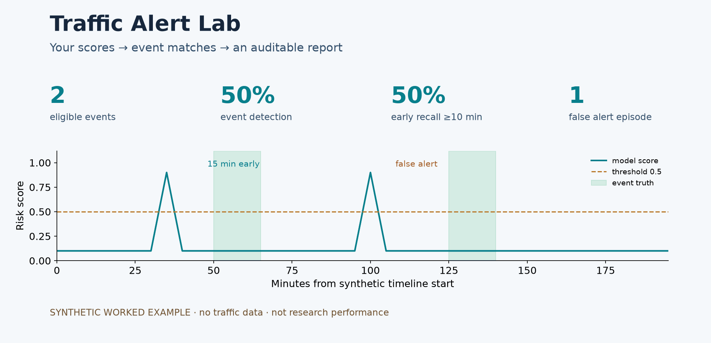

# Traffic Alert Lab

**导入模型分数，评测交通告警：发现了多少、提前多久、误报多少。**

支持自己的 CSV、可审计的事件报告和真正训练的小型 CPU PyTorch 教程。

[English](README.md) · [在线研究演示](https://lanausee-debug.github.io/traffic-alert-lab/) · [CSV使用说明](docs/csv_evaluation.zh-CN.md) · [训练Notebook](notebooks/tiny_training.ipynb) · [Colab入口](https://colab.research.google.com/github/lanausee-debug/traffic-alert-lab/blob/main/notebooks/tiny_training.ipynb)



预览来自可手算的合成示例，不是论文性能。通用评测只需要 Python 3.12 标准库，不用下载交通数据或模型。

## 先生成一份报告

```bash
python alert_eval.py examples/synthetic_alerts.csv --threshold 0.5 --synthetic --output runs/example-report
```

打开 `runs/example-report/report.html`。JSON还保存逐事件匹配、告警分类、排除记录和输入SHA。自己的CSV准备 `station_id,timestamp,score,is_event` 四列，替换输入路径并去掉 `--synthetic` 即可。[格式与指标规则](docs/csv_evaluation.zh-CN.md)。每次使用新的输出目录。

阈值要在独立校准集提前选好，分数必须在所填时刻已经可用于决策。真值只用于训练目标或评测。通用工具与论文冻结评测是两个协议，不能相互替换结果。

## 真正训练一个小模型

```bash
python -m pip install torch==2.8.0 --index-url https://download.pytorch.org/whl/cpu
python train_tiny_alert.py --output runs/tiny-first
```

默认实际更新120次参数，合成训练、校准、测试使用独立时间序列。输出损失记录、预测CSV和事件报告。[逐步讲解PyTorch](docs/tiny_training.zh-CN.md)。Notebook代码单元已在本机CPU执行，Colab云端尚未实测。合成成绩不作为真实交通证据。

## 查看和复现原研究

[在线演示](https://lanausee-debug.github.io/traffic-alert-lab/)展示七方法、三情景的冻结汇总结果，离线也可打开 `demo/index.html`；没有在线模型推理或真实逐站窗口。

**预定联合主检验未通过。** 起点MLP误报较少，但含迟报检测明显下降，当前没有建立原创架构或整体服务优势。

```bash
python verify_release.py
python build_thesis_experiment_draft.py --check
python -m unittest discover -s tests -p test_csv_alerts.py -v
```

这些命令核对冻结文件、结果和通用工具；不会重训论文模型。哈希核对后自动还原三份压缩参考JSON，不覆盖已改动记录。原来的[张量与反向传播课](docs/undergraduate_pytorch_learning.zh-CN.md)仍保留，它与新增实际训练课不同，更新次数为0。

## 原实验结果

| 细网格方法 | ≥10分钟代理预警召回 | 含迟报检测 | 误报/有效站日 |
| --- | --- | --- | --- |
| 全局校准 | 8.92% | 80.39% | 0.187396 |
| 可用性分组校准 | 8.47% | 80.14% | 0.179023 |
| 起点逻辑回归 | 10.85% | 36.80% | 0.096126 |
| 起点MLP | 11.89% | 28.18% | 0.086581 |

24站子集、83日、673个完整低速代理事件，三情景等权平均。三个情景复用同一事件真值，不能当三倍独立样本。起点MLP相对全局的R10差值为+2.97个百分点，97.5%区间[−0.20,5.89]，包含零；相对分组为+3.42，[0.36,6.29]。预定两项下界都大于零的联合要求未通过，检测比全局下降52.20个百分点。

代理提前量使用 `L=5(s−a+1)`，尚未独立核验真实拥堵起点。完整七方法结果见[附表](docs/thesis_result_tables.zh-CN.md)。

## 从零复现

```powershell
py -3.12 -m venv .venv
& .\.venv\Scripts\python.exe -m pip install -r requirements-pilot.txt --extra-index-url https://download.pytorch.org/whl/cpu
& .\.venv\Scripts\python.exe restore_reference_records.py
& .\.venv\Scripts\python.exe run_pems_bay_pipeline.py --workspace runs/my-first-run --data C:/path/to/pems-bay.h5
```

原数据由使用者依照上游入口取得，不随仓库分发。统一入口在新目录执行18阶段，支持 `--resume` 和 `--verify-only`。已有一次本机完整流程与原结果数值一致，约22分钟是当时记录，不是运行时间保证。重跑已分析数据是工程复现，不能称新的独立确认。

项目代码和原创文档采用[MIT许可证](LICENSE)，数据与第三方材料保留原范围。详见 [CODE_LICENSE.md](CODE_LICENSE.md)、[数据范围](DATA_POLICY.md)和[来源说明](THIRD_PARTY_NOTICES.md)。学校论文、Word/PPT、真实回放窗口、数据、权重与缓存不在本公开包内。历史记录中的“尚未上传”等表述按其记录日期理解。

## 在线部署

[直接打开在线演示](https://lanausee-debug.github.io/traffic-alert-lab/)，无需安装依赖。GitHub Pages展示同一份已核对的汇总结果，不包含逐站速度窗口，也不在线运行模型。main分支后续更新会触发部署，实际状态以Actions为准。
